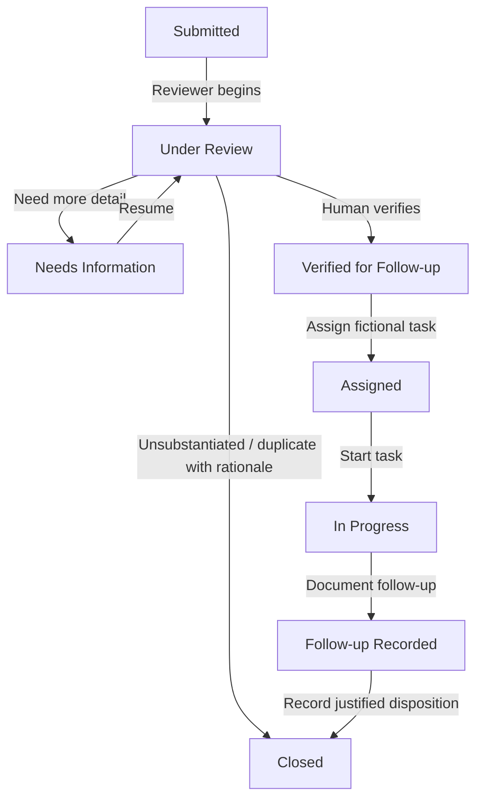

# PenyuGuard architecture — implemented prototype

## Components

- `index.html` — application entry point.
- `styles.css` — responsive custom design system and print rules.
- `assets/*.svg` — bundled original vector artwork.
- `js/icons.js` — local SVG icon renderer.
- `js/domain.js` — typed-by-convention domain vocabulary, seeded data, repository, validation, centralized transitions, metrics and public projection.
- `js/app.js` — route rendering, event delegation, forms, chart rendering, browser image compression, export and demo control room.
- `serve.mjs` — small Node HTTP server (no third-party dependency).
- `build.mjs` — copies deployable static resources to `dist/`.

## Single source of truth

`localStorage['penyuguard:v3']` holds the array of cases, their append-only events, tasks, sequence and active demo case ID. A local repository function updates state and persists a coherent snapshot, then notifies UI listeners. All pages and metrics reference this state. `sessionStorage` stores demonstration role and form draft.

## Data model summary

`TurtleCase`: ID, created/observed times, category, status, general public zone, optional internal demo location note, observed conditions, description, optional locally compressed JPEG data URL, review decision and timestamp, duplicate link, disposition, task IDs, timeline events.

`CaseEvent`: ID, case ID, occurrence timestamp, event type, actor demo role, title, public summary, optional internal note. Events are appended, not edited, by transitions.

`ResponseTask`: ID, related case, fictional assigned team, action type, task status, creation/completion times and outcome note.

## Valid case lifecycle

`transitionCase(id, action, payload, actingDemoRole)` checks the stage, expected role, rationale and required fields. It creates a new snapshot with an event and persists it. Both malformed transitions and unjustified closure are rejected. This is demo-level UI/data consistency only; a user can manipulate browser storage and choose any role.

## Privacy and threat model

`publicCase()` constructs a new object containing only public-safe fields and public event summaries. It intentionally omits private location notes, internal reviewer rationales, and task metadata. Public print and download use that projection even if the current demo role is reviewer. This UI-level filtering should **not** be relied upon for real sensitive information, because complete records remain readable in client-side storage.

## Explainable assistant

- Completeness score counts four recommended reporting fields: description quality, known general zone, optional image, and observed condition.
- A preliminary prompt-review flag is based on selected categories only, not photographed injury recognition or veterinary triage.
- Possible duplicate candidates have matching category, broad zone and observation timestamp within six hours. A human reviewer decides whether to close a case as duplicate.

## Future production architecture (not implemented)

React/TypeScript UI → authenticated API → access-controlled PostgreSQL → encrypted object store for evidence → audit log → authorized conservation reviewers and carefully governed official response integration. Exact sensitive wildlife locations should be kept in restricted server-side storage with data retention rules and stakeholder-reviewed protocols.
